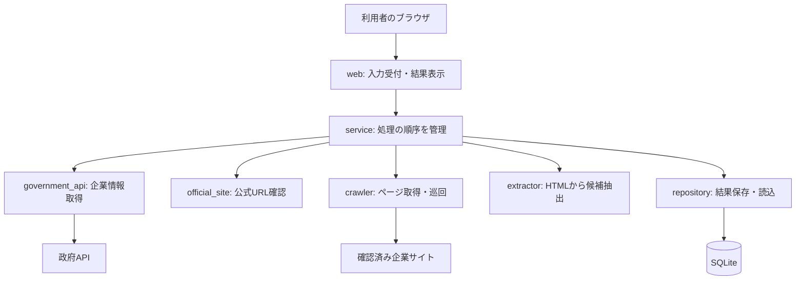

# アーキテクチャ案

更新日: 2026-11-24（日本時間）
状態: 課題0で基本要件を確認済み。技術・詳細仕様は引き続き検討する。

## 課題0で確認した要件

- 対象は障害者雇用の求人へ応募したい人。利用者の応募資格をアプリが判定する機能は要件に含めていない。
- 検索入力は職種と勤務地。下記の企業名検索は企業収集のための内部処理候補であり、利用者の検索入力とは分ける。
- 結果は求人ごとのカードで表示する。初期項目は企業名・職種・勤務地・募集ページURL・確認日時。必要に応じて追加する。
- 確認日時は取得した時点の情報を示し、現在募集中であることを保証しない。利用者が元ページで募集継続を確認できるようにする。
- 具体的な職が提示されていない紹介・取り組みページは求人候補に含めない。
- 取得失敗時の文言は「ページの取得に失敗しました」。公式URL不明・候補未検出の文言は未決定。
- 取得成功でも、取り組み紹介だけで具体的な募集がなければ候補未検出とする。このケースの分類を学習者と確認済み。
- データの流れは、政府APIで企業を収集 → 公式サイトから職種・勤務地を含む求人候補を収集 → 利用者の条件で絞り込む → カード表示、に修正する案。政府APIだけで求人の職種・勤務地を検索できるとは仮定しない。収集範囲と実行タイミングは今後決める。

## 目的と要件

政府APIから企業情報を取得し、企業の公式サイトにある障害者雇用の求人候補を探す。利用者が根拠のページを開いて募集内容を確認できるWebアプリを作る。あわせて、学習者が構造・実装・技術選定を説明できるようになる。

### 最初に完成させる範囲（提案）

- ローカルで本人が利用する。最初は企業1社、続いて少数社を扱う。
- 企業名などで政府APIを検索し、法人番号・名称・所在地を取得する。
- 公式URLを確認し、未取得なら利用者が入力・確認できるようにする。APIが公式URLを必ず返すとは仮定しない。
- 確認済み公式サイトの静的HTMLから採用関連リンクを探し、障害者雇用の求人候補を抽出する。
- 企業名・候補ページURL・根拠となった短い文章・確認日時・探索状況を画面に表示する。
- 結果を保存し、再表示する。募集継続中かどうかの最終確認は元ページで行う。

### 品質要件（上限値は課題で決定）

- 「候補あり」「探索範囲内で候補未検出」「取得失敗」「手動確認が必要」を区別する。
- 取得先の利用条件とrobots.txtを確認し、アクセス間隔・ページ数・深さ・タイムアウトに上限を設ける。
- 同じURLを繰り返し巡回しない。公式ドメイン外の採用サービスは初期版では手動確認に回す。
- APIトークンは環境変数で扱い、画面・ログ・Gitに記録しない。
- Webから入力するURLはHTTP/HTTPSの公開先に限定する。内部アドレス等へのアクセスを防ぎ、転送先も検査する。
- 操作にはラベルを付け、キーボードで利用できる画面を目指す。
- 初期版ではログイン、大規模巡回、定期実行、JavaScript実行、PDF解析、AI判定、公開運用を対象外とする。

## 構成図



これは最終形の案であり、最初から全モジュールは作らない。

## データの流れ

1. 利用者の企業検索条件を検証する。
2. 政府APIの応答を、アプリで使う企業情報に揃える。同名企業は法人番号と所在地で区別する。
3. 公式URLの出典と確認状況を記録する。不明なら自動探索を止め、手動確認に回す。
4. 取得条件を確認して、上限内でHTMLを取得する。
5. HTMLからリンク・本文を取り出し、採用情報と障害者雇用の文脈を確認して候補を作る。
6. URLの重複を除き、根拠・確認日時・探索状況とともに保存する。
7. 結果を表示する。未検出を求人不存在と解釈しない。

## モジュールの役割と依存

| モジュール | 担当 | 依存先 |
|---|---|---|
| models | 企業・候補・探索結果の共通データ形式 | 初めはPythonの標準型 |
| government_api | 認証、企業検索、応答の変換 | HTTPX、models、config |
| official_site | URLの出典・企業との対応・確認状態 | models |
| crawler | URL検証、取得条件、巡回上限、HTML取得 | HTTPX、config |
| extractor | 受け取ったHTMLからリンク・候補・根拠を抽出。通信しない | Beautiful Soup、models |
| repository | 保存と読込 | SQLite、models |
| service | 上記を必要な順序で呼び出す | 各処理モジュール |
| web | HTTP入力と画面表示 | FastAPI、service |
| config | 設定・環境変数の読込 | 標準ライブラリ等 |

依存の矢印は「呼び出す側 → 呼び出される側」。extractorからwebやDBを呼ばない。通信と解析を分けると、保存HTMLで解析を試せる。

## 技術候補と選定理由

| 技術 | 使用時期・理由 |
|---|---|
| Python | 全工程。既習範囲を確認し、関数・辞書・リストから始める |
| HTTPX | APIとHTMLのHTTP通信。既存requirementsにある。初めは同期処理（1件ずつ待つ方式） |
| Beautiful Soup | HTMLの要素・リンクを抽出。ブラウザ操作より小さく始められる |
| FastAPI + Uvicorn | Python処理をWebから呼べるようにし、アプリを起動する。既存requirementsにある |
| HTML + 必要ならJinja2 | Python側で結果を埋め込んだ画面を返す。別のJavaScriptアプリを作る負担を避ける。Jinja2追加は導入時に説明 |
| SQLite（sqlite3） | 最初の保存先候補。Python標準機能で、DBサーバーの準備を減らす |
| unittest | 分岐・通信失敗・解析の確認に必要になった段階で導入する標準テスト機能 |
| 環境変数 / python-dotenv | APIトークンと設定をコードから分ける。dotenvは必要になった時に説明 |

requirementsにあるSQLAlchemy・psycopgは、採用済みとは扱わない。PostgreSQLやORM（Pythonの操作をDB操作へ対応させる仕組み）は必要性を説明できる段階で再検討する。依存ファイルは変更していない。

政府API候補はGビズインフォと国税庁法人番号システム。Gビズインフォ公式案内はREST API v2と事前申請・トークンを案内している。国税庁は法人番号・名称・所在地などの取得候補。実際の検索条件、URL項目、欠損、制限を確認して選ぶ。

## 最終ディレクトリ構成案

以下は予定であり、ソースファイルは未作成。

```text
disability-job-search/
├── ARCHITECTURE.md
├── ROADMAP.md
├── DESIGN.md
├── LEARNING.md
├── README.md
├── requirements.txt
├── .env                 # ローカルのみ。既存の内容は読まない
├── .gitignore
├── app/
│   ├── __init__.py
│   ├── web.py
│   ├── service.py
│   ├── models.py
│   ├── config.py
│   ├── government_api.py
│   ├── official_site.py
│   ├── crawler.py
│   ├── extractor.py
│   ├── repository.py
│   ├── templates/
│   │   └── index.html
│   └── static/
│       └── style.css
├── tests/
│   ├── fixtures/        # API応答例・小さなHTML例
│   └── test_*.py
└── data/                # ローカルDB。Git管理方針は保存工程で決める
```

## 参考（2026-11-24確認）

- Gビズインフォ: https://content.info.gbiz.go.jp/api/index.html
- 国税庁API: https://www.houjin-bangou.nta.go.jp/webapi/
- Python: https://docs.python.org/ja/3/tutorial/datastructures.html
- HTTPX: https://www.python-httpx.org/
- Beautiful Soup: https://www.crummy.com/software/BeautifulSoup/bs4/doc/
- FastAPI: https://fastapi.tiangolo.com/

将来の実装時には導入済みPython・ライブラリのバージョンと公式仕様を再確認する。
